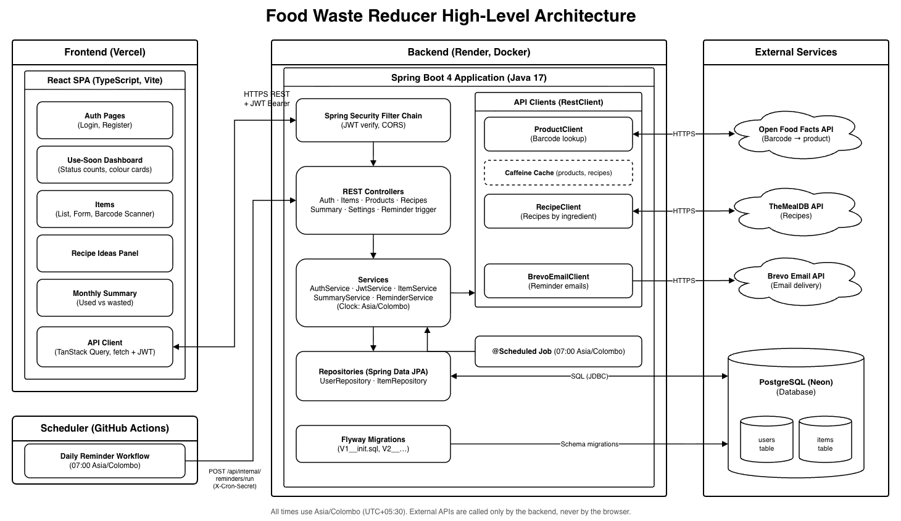

# Food Waste Reducer

Food Waste Reducer tracks the food in your kitchen, warns you before it expires, then suggests recipes to use it up.

## Problem

- Households forget what is in the fridge or pantry, so food expires unnoticed.
- Expired food is thrown away, wasting money.
- People rarely check expiry dates until it is too late.
- Existing apps are paid, full of ads, or too complex.

## Features

1. Register and log in.
2. Add, edit, delete food items: name, category, quantity, expiry date.
3. Barcode lookup fills in the product name automatically (type the number or scan with the phone camera).
4. **Use soon** dashboard, colour-coded:
   - Red: expired
   - Orange: expires within 2 days
   - Yellow: expires within 7 days
   - Green: later
5. Mark an item as **used** or **wasted**.
6. Recipe ideas for an expiring item.
7. Daily email at 7:00 AM (Sri Lanka time) listing items expiring within 2 days; can be switched off.
8. Monthly summary of items used vs wasted.

## Tech stack

| Layer | Technologies |
| --- | --- |
| Frontend | React, TypeScript, Vite, React Router, TanStack Query, React Hook Form, Zod, Tailwind CSS, @zxing/browser |
| Backend | Java 17, Spring Boot 4, Spring Web, Spring Data JPA, Spring Security (JWT), Bean Validation, Flyway, Spring Cache + Caffeine, Actuator, Maven |
| Database | PostgreSQL |
| External APIs | Open Food Facts (barcodes), TheMealDB (recipes), Brevo (email) |
| Testing | JUnit 5, Mockito, AssertJ, Testcontainers, Vitest, React Testing Library, Playwright |
| DevOps | Git, GitHub, Docker, Docker Compose, GitHub Actions |
| Hosting | Vercel (frontend), Render (backend), Neon (database) |

## Architecture

